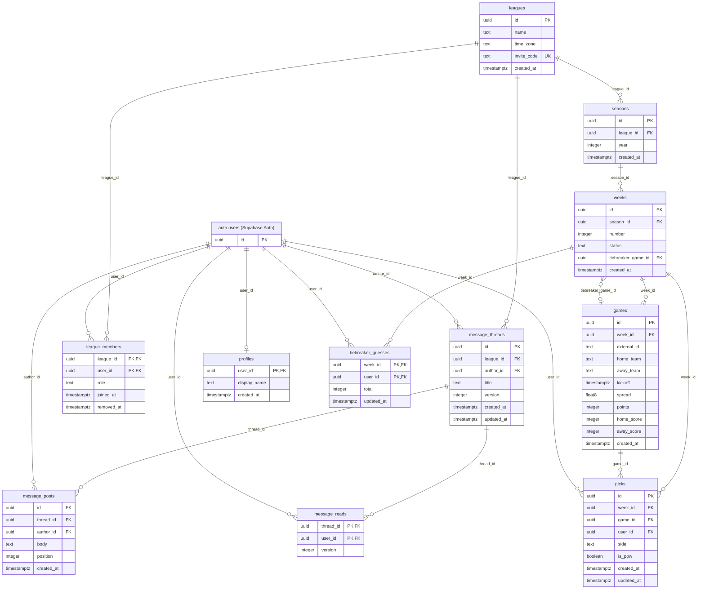

# Database schema

<!-- Generated by `pnpm db:erd` from packages/db/src/schema.ts. Do not edit by hand: CI fails if it is out of date. -->

This file is generated from the Drizzle schema in `packages/db/src/schema.ts`, which is the source of truth.
To change the database, edit that file and run `pnpm db:generate --name <desc>`; it writes the migration and
refreshes this page. For an interactive view of a running database, open Supabase Studio (URL from
`pnpm ports`) and go to Database → Schema Visualizer.

Every table has row-level security enabled with no policies: only the API, which connects as a privileged
role, can read or write them.

## Diagram

Lines read parent to child and are labelled with the child's foreign-key column.

## Tables

### `games`

A game on a week's slate, with the spread and point value the league is using for it.

| Column | Type | Null | Key | Description |
| --- | --- | --- | --- | --- |
| `id` | uuid | no | PK | Has a default. |
| `week_id` | uuid | no | FK → `weeks.id` |  |
| `external_id` | text | yes |  | The schedule provider's id for the game; null for games the admin added by hand. |
| `home_team` | text | no |  | Team abbreviation, e.g. "PHI". |
| `away_team` | text | no |  | Team abbreviation, e.g. "DAL". |
| `kickoff` | timestamptz | no |  |  |
| `spread` | float8 | yes |  | The home team's line: -3.5 means the home team is favored by 3.5. Null until a line is set. |
| `points` | integer | no |  | What a correct pick is worth. |
| `home_score` | integer | yes |  | Final score. Null until the game is final; a game with a score is closed to picks. |
| `away_score` | integer | yes |  | Final score. Null until the game is final. |
| `created_at` | timestamptz | no |  | Has a default. |

Unique together: (`week_id`, `external_id`).

### `league_members`

Who is in a league, and whether they run it.

| Column | Type | Null | Key | Description |
| --- | --- | --- | --- | --- |
| `league_id` | uuid | no | PK, FK → `leagues.id` |  |
| `user_id` | uuid | no | PK, FK → `auth.users.id` |  |
| `role` | text | no |  | One of: `admin`, `member`. Has a default. |
| `joined_at` | timestamptz | no |  | Has a default. |
| `removed_at` | timestamptz | yes |  | Set when the admin removes the player. They lose access, but stay in the results of weeks already played. |

### `leagues`

A group of players who pick against each other, run by league admins.

| Column | Type | Null | Key | Description |
| --- | --- | --- | --- | --- |
| `id` | uuid | no | PK | Has a default. |
| `name` | text | no |  |  |
| `time_zone` | text | no |  | IANA zone the 6am game-day lock is measured in. Has a default. |
| `invite_code` | text | no | unique | Anyone holding this code can join. Admins can rotate it. |
| `created_at` | timestamptz | no |  | Has a default. |

### `message_posts`

The opening message and subsequent replies, ordered within a thread.

| Column | Type | Null | Key | Description |
| --- | --- | --- | --- | --- |
| `id` | uuid | no | PK | Has a default. |
| `thread_id` | uuid | no | FK → `message_threads.id` |  |
| `author_id` | uuid | no | FK → `auth.users.id` |  |
| `body` | text | no |  |  |
| `position` | integer | no |  |  |
| `created_at` | timestamptz | no |  | Has a default. |

Unique together: (`thread_id`, `position`).

### `message_reads`

Highest post actually viewed by a player; older tabs cannot move it backwards.

| Column | Type | Null | Key | Description |
| --- | --- | --- | --- | --- |
| `thread_id` | uuid | no | PK, FK → `message_threads.id` |  |
| `user_id` | uuid | no | PK, FK → `auth.users.id` |  |
| `version` | integer | no |  |  |

### `message_threads`

A league-wide conversation, independent of the selected season.

| Column | Type | Null | Key | Description |
| --- | --- | --- | --- | --- |
| `id` | uuid | no | PK | Has a default. |
| `league_id` | uuid | no | FK → `leagues.id` |  |
| `author_id` | uuid | no | FK → `auth.users.id` |  |
| `title` | text | no |  |  |
| `version` | integer | no |  | Sequential post count; also the unread watermark. Updated under a row lock. Has a default. |
| `created_at` | timestamptz | no |  | Has a default. |
| `updated_at` | timestamptz | no |  | Has a default. |

### `picks`

A player's pick of one side of one game.

| Column | Type | Null | Key | Description |
| --- | --- | --- | --- | --- |
| `id` | uuid | no | PK | Has a default. |
| `week_id` | uuid | no | FK → `weeks.id` | Denormalized from the game so "one POW per player per week" can be a unique index. |
| `game_id` | uuid | no | FK → `games.id` |  |
| `user_id` | uuid | no | FK → `auth.users.id` |  |
| `side` | text | no |  | The team picked to beat the spread. One of: `home`, `away`. |
| `is_pow` | boolean | no |  | The player's Pick of the Week. At most one per player per week. Has a default. |
| `created_at` | timestamptz | no |  | Has a default. |
| `updated_at` | timestamptz | no |  | Has a default. |

Unique together: (`game_id`, `user_id`).

Unique among rows matching a condition: (`week_id`, `user_id`), index `picks_one_pow_per_week` (the condition is in `schema.ts`).

### `profiles`

What a player is called on leaderboards.

| Column | Type | Null | Key | Description |
| --- | --- | --- | --- | --- |
| `user_id` | uuid | no | PK, FK → `auth.users.id` |  |
| `display_name` | text | no |  |  |
| `created_at` | timestamptz | no |  | Has a default. |

### `seasons`

One NFL season of a league. A league keeps its members from year to year.

| Column | Type | Null | Key | Description |
| --- | --- | --- | --- | --- |
| `id` | uuid | no | PK | Has a default. |
| `league_id` | uuid | no | FK → `leagues.id` |  |
| `year` | integer | no |  | The year the NFL season starts in. |
| `created_at` | timestamptz | no |  | Has a default. |

Unique together: (`league_id`, `year`).

### `tiebreaker_guesses`

A player's guess at the combined score of the week's tiebreaker game.

| Column | Type | Null | Key | Description |
| --- | --- | --- | --- | --- |
| `week_id` | uuid | no | PK, FK → `weeks.id` |  |
| `user_id` | uuid | no | PK, FK → `auth.users.id` |  |
| `total` | integer | no |  | Guessed combined points of both teams. |
| `updated_at` | timestamptz | no |  | Has a default. |

### `weeks`

One week of a season: the unit players pick, and the admin opens and closes.

| Column | Type | Null | Key | Description |
| --- | --- | --- | --- | --- |
| `id` | uuid | no | PK | Has a default. |
| `season_id` | uuid | no | FK → `seasons.id` |  |
| `number` | integer | no |  | Regular-season week, 1–18. |
| `status` | text | no |  | draft: the admin is setting games and spreads. open: players pick. final: scored, picks revealed. One of: `draft`, `open`, `final`. Has a default. |
| `tiebreaker_game_id` | uuid | yes | FK → `games.id` | The admin's explicit choice of tiebreaker game. Null means "use the default" (the last Monday game, else the last game), worked out from the slate on every read. Players guess this game's total, and it receives automatic POWs. |
| `created_at` | timestamptz | no |  | Has a default. |

Unique together: (`season_id`, `number`).
