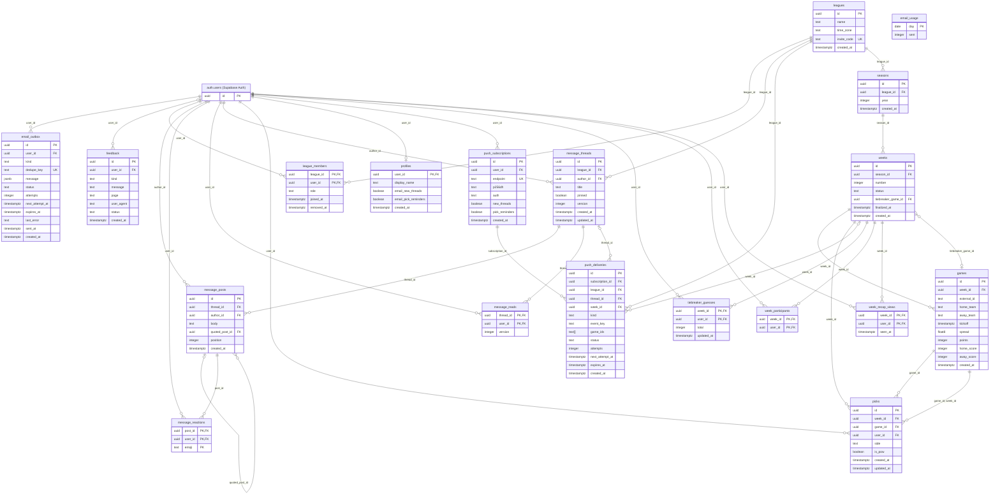

# Database schema

<!-- Generated by `pnpm db:erd` from packages/db/src/schema.ts. Do not edit by hand: CI fails if it is out of date. -->

This file is generated from the Drizzle schema in `packages/db/src/schema.ts`, which is the source of truth.
To change the database, edit that file and run `pnpm db:generate --name <desc>`; it writes the migration and
refreshes this page. For an interactive view of a running database, open Supabase Studio (URL from
`pnpm ports`) and go to Database → Schema Visualizer.

Every table has row-level security enabled with no policies: only the API, which connects as a privileged
role, can read or write them.

## Diagram

Lines read parent to child and are labelled with the child's foreign-key column.

## Tables

### `email_outbox`

Emails waiting to be sent, and a short history of those that were. Rows are queued with their content already rendered; the address is looked up at send time from `auth.users`, so it is never copied here.

| Column | Type | Null | Key | Description |
| --- | --- | --- | --- | --- |
| `id` | uuid | no | PK | Has a default. |
| `user_id` | uuid | no | FK → `auth.users.id` |  |
| `kind` | text | no |  | One of: `new_thread`, `pick_reminder`. |
| `dedupe_key` | text | no | unique | Identifies the email's purpose (e.g. `thread:<id>:<user>`) so a retried or repeated job never queues it twice. |
| `message` | jsonb | no |  | Rendered message: subject, HTML and plain-text bodies, and the one-click unsubscribe URL for its headers. |
| `status` | text | no |  | pending → sending → sent; or failed (gave up), or skipped (no address, opted out, or too late to be useful). One of: `pending`, `sending`, `sent`, `failed`, `skipped`. Has a default. |
| `attempts` | integer | no |  | Has a default. |
| `next_attempt_at` | timestamptz | no |  | When a pending row may next be tried; also when a `sending` claim is considered abandoned. Has a default. |
| `expires_at` | timestamptz | no |  | After this the email is no longer worth sending and is skipped. |
| `last_error` | text | yes |  | A known error code from the last failed attempt (never provider prose). |
| `sent_at` | timestamptz | yes |  |  |
| `created_at` | timestamptz | no |  | Has a default. |

### `email_usage`

Notification emails handed to Cloudflare Email Sending per UTC day. The API reserves a slot here before every send and stops at its daily and monthly limits, a safety cap against runaway sending. Auth's own emails don't pass through the API and aren't counted here.

| Column | Type | Null | Key | Description |
| --- | --- | --- | --- | --- |
| `day` | date | no | PK | The UTC calendar day. |
| `sent` | integer | no |  | Sends reserved that day. A send the provider refused is given back. Has a default. |

### `feedback`

A bug report, feature request or note a player sent to the people who run the app. Read on the operator screen.

| Column | Type | Null | Key | Description |
| --- | --- | --- | --- | --- |
| `id` | uuid | no | PK | Has a default. |
| `user_id` | uuid | yes | FK → `auth.users.id` | Who sent it. Null once that account is deleted; the report is kept. |
| `kind` | text | no |  | One of: `bug`, `feature`, `other`. |
| `message` | text | no |  |  |
| `page` | text | yes |  | The app path the player was on when they opened the form, e.g. "/leagues/<id>/standings". |
| `user_agent` | text | yes |  | The browser's user agent, to help reproduce a bug. |
| `status` | text | no |  | open: not dealt with yet. done: the operator has handled it. One of: `open`, `done`. Has a default. |
| `created_at` | timestamptz | no |  | Has a default. |

### `games`

A game on a week's slate, with the spread and point value the league is using for it.

| Column | Type | Null | Key | Description |
| --- | --- | --- | --- | --- |
| `id` | uuid | no | PK | Has a default. |
| `week_id` | uuid | no | FK → `weeks.id` |  |
| `external_id` | text | yes |  | The schedule provider's id for the game; null for games the admin added by hand. |
| `home_team` | text | no |  | Team abbreviation, e.g. "PHI". |
| `away_team` | text | no |  | Team abbreviation, e.g. "DAL". |
| `kickoff` | timestamptz | no |  |  |
| `spread` | float8 | yes |  | The home team's line: -3.5 means the home team is favored by 3.5. Null until a line is set. |
| `points` | integer | no |  | What a correct pick is worth. |
| `home_score` | integer | yes |  | Final score. Null until the game is final; a game with a score is closed to picks. |
| `away_score` | integer | yes |  | Final score. Null until the game is final. |
| `created_at` | timestamptz | no |  | Has a default. |

Unique together: (`week_id`, `external_id`); (`id`, `week_id`).

### `league_members`

Who is in a league, and whether they run it.

| Column | Type | Null | Key | Description |
| --- | --- | --- | --- | --- |
| `league_id` | uuid | no | PK, FK → `leagues.id` |  |
| `user_id` | uuid | no | PK, FK → `auth.users.id` |  |
| `role` | text | no |  | One of: `admin`, `member`. Has a default. |
| `joined_at` | timestamptz | no |  | Has a default. |
| `removed_at` | timestamptz | yes |  | Set when the admin removes the player. They lose access, but stay in the results of weeks already played. |

### `leagues`

A group of players who pick against each other, run by league admins.

| Column | Type | Null | Key | Description |
| --- | --- | --- | --- | --- |
| `id` | uuid | no | PK | Has a default. |
| `name` | text | no |  |  |
| `time_zone` | text | no |  | IANA zone game days and kickoff times are shown in. Has a default. |
| `invite_code` | text | no | unique | Anyone holding this code can join. Admins can rotate it. |
| `created_at` | timestamptz | no |  | Has a default. |

### `message_posts`

The opening message and subsequent replies, ordered within a thread.

| Column | Type | Null | Key | Description |
| --- | --- | --- | --- | --- |
| `id` | uuid | no | PK | Has a default. |
| `thread_id` | uuid | no | FK → `message_threads.id` |  |
| `author_id` | uuid | no | FK → `auth.users.id` |  |
| `body` | text | no |  |  |
| `quoted_post_id` | uuid | yes | FK → `message_posts.id` | Optional original message quoted by this reply; the API restricts it to the same thread. |
| `position` | integer | no |  |  |
| `created_at` | timestamptz | no |  | Has a default. |

Unique together: (`thread_id`, `position`).

### `message_reactions`

A player's emoji on a message; each emoji can be added once and removed independently.

| Column | Type | Null | Key | Description |
| --- | --- | --- | --- | --- |
| `post_id` | uuid | no | PK, FK → `message_posts.id` |  |
| `user_id` | uuid | no | PK, FK → `auth.users.id` |  |
| `emoji` | text | no | PK |  |

### `message_reads`

Highest post actually viewed by a player; older tabs cannot move it backwards.

| Column | Type | Null | Key | Description |
| --- | --- | --- | --- | --- |
| `thread_id` | uuid | no | PK, FK → `message_threads.id` |  |
| `user_id` | uuid | no | PK, FK → `auth.users.id` |  |
| `version` | integer | no |  |  |

### `message_threads`

A league-wide conversation, independent of the selected season.

| Column | Type | Null | Key | Description |
| --- | --- | --- | --- | --- |
| `id` | uuid | no | PK | Has a default. |
| `league_id` | uuid | no | FK → `leagues.id` |  |
| `author_id` | uuid | no | FK → `auth.users.id` |  |
| `title` | text | no |  |  |
| `pinned` | boolean | no |  | Admin-pinned announcements appear before other conversations. Has a default. |
| `version` | integer | no |  | Sequential post count; also the unread watermark. Updated under a row lock. Has a default. |
| `created_at` | timestamptz | no |  | Has a default. |
| `updated_at` | timestamptz | no |  | Has a default. |

### `picks`

A player's pick of one side of one game.

| Column | Type | Null | Key | Description |
| --- | --- | --- | --- | --- |
| `id` | uuid | no | PK | Has a default. |
| `week_id` | uuid | no | FK → `weeks.id` | Denormalized from the game so "one POW per player per week" can be a unique index. |
| `game_id` | uuid | no | FK → `games.id` |  |
| `user_id` | uuid | no | FK → `auth.users.id` |  |
| `side` | text | no |  | The team picked to beat the spread. One of: `home`, `away`. |
| `is_pow` | boolean | no |  | The player's Pick of the Week. At most one per player per week. Has a default. |
| `created_at` | timestamptz | no |  | Has a default. |
| `updated_at` | timestamptz | no |  | Has a default. |

Unique together: (`game_id`, `user_id`).

Unique among rows matching a condition: (`week_id`, `user_id`), index `picks_one_pow_per_week` (the condition is in `schema.ts`).

### `profiles`

What a player is called on leaderboards, and which emails they want.

| Column | Type | Null | Key | Description |
| --- | --- | --- | --- | --- |
| `user_id` | uuid | no | PK, FK → `auth.users.id` |  |
| `display_name` | text | no |  |  |
| `email_new_threads` | boolean | no |  | Email the player when someone starts a message thread in one of their leagues. Has a default. |
| `email_pick_reminders` | boolean | no |  | Email the player the evening before a game day on which they still have games to pick. Has a default. |
| `created_at` | timestamptz | no |  | Has a default. |

### `push_deliveries`

Durable per-device delivery queue. Unique event keys prevent repeated cron calls from queuing twice.

| Column | Type | Null | Key | Description |
| --- | --- | --- | --- | --- |
| `id` | uuid | no | PK | Has a default. |
| `subscription_id` | uuid | no | FK → `push_subscriptions.id` |  |
| `league_id` | uuid | no | FK → `leagues.id` |  |
| `thread_id` | uuid | yes | FK → `message_threads.id` |  |
| `week_id` | uuid | yes | FK → `weeks.id` |  |
| `kind` | text | no |  | One of: `new_thread`, `pick_reminder`. |
| `event_key` | text | no |  | Thread id or week id + local game date, scoped to subscription by the unique index. |
| `game_ids` | text[] | no |  | Game ids are rechecked for missing picks immediately before a reminder is sent. Has a default. |
| `status` | text | no |  | One of: `pending`, `sent`, `skipped`, `failed`. Has a default. |
| `attempts` | integer | no |  | Has a default. |
| `next_attempt_at` | timestamptz | no |  | Has a default. |
| `expires_at` | timestamptz | no |  |  |
| `created_at` | timestamptz | no |  | Has a default. |

Unique together: (`subscription_id`, `kind`, `event_key`).

### `push_subscriptions`

A browser/device explicitly opted into push for one player. Endpoints and keys are private capabilities.

| Column | Type | Null | Key | Description |
| --- | --- | --- | --- | --- |
| `id` | uuid | no | PK | Has a default. |
| `user_id` | uuid | no | FK → `auth.users.id` |  |
| `endpoint` | text | no | unique | Only supported HTTPS browser push services; never returned to other players or logged. |
| `p256dh` | text | no |  |  |
| `auth` | text | no |  |  |
| `new_threads` | boolean | no |  | Preferences apply to this device, independently of the player's other devices. Has a default. |
| `pick_reminders` | boolean | no |  | Has a default. |
| `created_at` | timestamptz | no |  | Has a default. |

### `seasons`

One NFL season of a league. A league keeps its members from year to year.

| Column | Type | Null | Key | Description |
| --- | --- | --- | --- | --- |
| `id` | uuid | no | PK | Has a default. |
| `league_id` | uuid | no | FK → `leagues.id` |  |
| `year` | integer | no |  | The year the NFL season starts in. |
| `created_at` | timestamptz | no |  | Has a default. |

Unique together: (`league_id`, `year`).

### `tiebreaker_guesses`

A player's guess at the combined score of the week's tiebreaker game.

| Column | Type | Null | Key | Description |
| --- | --- | --- | --- | --- |
| `week_id` | uuid | no | PK, FK → `weeks.id` |  |
| `user_id` | uuid | no | PK, FK → `auth.users.id` |  |
| `total` | integer | no |  | Guessed combined points of both teams. |
| `updated_at` | timestamptz | no |  | Has a default. |

### `week_participants`

Who a closed week is scored for, recorded when it is finalized: everyone in the league at its last kickoff, plus anyone who picked. Later membership changes (leaving, rejoining) never change it. Finalizing again after a reopen only adds players; nobody is dropped. Weeks finalized before this table existed have no rows and are worked out from the membership history instead.

| Column | Type | Null | Key | Description |
| --- | --- | --- | --- | --- |
| `week_id` | uuid | no | PK, FK → `weeks.id` |  |
| `user_id` | uuid | no | PK, FK → `auth.users.id` |  |

### `week_recap_views`

A player has been shown a closed week's results recap. It counts only if it is no older than the week's `finalizedAt`, so a week reopened and closed again is recapped again.

| Column | Type | Null | Key | Description |
| --- | --- | --- | --- | --- |
| `week_id` | uuid | no | PK, FK → `weeks.id` |  |
| `user_id` | uuid | no | PK, FK → `auth.users.id` |  |
| `seen_at` | timestamptz | no |  |  |

### `weeks`

One week of a season: the unit players pick, and the admin opens and closes.

| Column | Type | Null | Key | Description |
| --- | --- | --- | --- | --- |
| `id` | uuid | no | PK | Has a default. |
| `season_id` | uuid | no | FK → `seasons.id` |  |
| `number` | integer | no |  | Regular-season week, 1–18. |
| `status` | text | no |  | draft: the admin is setting games and spreads. open: players pick. final: scored, picks revealed. One of: `draft`, `open`, `final`. Has a default. |
| `tiebreaker_game_id` | uuid | yes | FK → `games.id` | The admin's explicit choice of tiebreaker game. Null means "use the default" (the last Monday game, else the last game), worked out from the slate on every read. Players guess this game's total. |
| `finalized_at` | timestamptz | yes |  | When the admin last closed the week. Null while it isn't final, and for weeks closed before results recaps existed, which never get one. |
| `created_at` | timestamptz | no |  | Has a default. |

Unique together: (`season_id`, `number`).
