# Database schema

<!-- Generated by `pnpm db:erd` from packages/db/src/schema.ts. Do not edit by hand: CI fails if it is out of date. -->

This file is generated from the Drizzle schema in `packages/db/src/schema.ts`, which is the source of truth.
To change the database, edit that file and run `pnpm db:generate --name <desc>`; it writes the migration and
refreshes this page. For an interactive view of a running database, open Supabase Studio (URL from
`pnpm ports`) and go to Database → Schema Visualizer.

Every table has row-level security enabled with no policies: only the API, which connects as a privileged
role, can read or write them.

## Diagram

```mermaid
erDiagram
  message_posts |o--o{ content_reports : "post_id"
  auth_users |o--o{ content_reports : "subject_user_id"
  leagues |o--o{ content_reports : "league_id"
  auth_users |o--o{ content_reports : "reporter_id"
  auth_users |o--o{ content_reports : "resolved_by"
  auth_users ||--o{ email_outbox : "user_id"
  auth_users |o--o{ feedback : "user_id"
  weeks ||--o{ games : "week_id"
  leagues ||--o{ league_members : "league_id"
  auth_users ||--o{ league_members : "user_id"
  message_threads ||--o{ message_posts : "thread_id"
  auth_users ||--o{ message_posts : "author_id"
  message_posts |o--o{ message_posts : "quoted_post_id"
  auth_users |o--o{ message_posts : "removed_by"
  message_posts ||--o{ message_reactions : "post_id"
  auth_users ||--o{ message_reactions : "user_id"
  message_threads ||--o{ message_reads : "thread_id"
  auth_users ||--o{ message_reads : "user_id"
  leagues ||--o{ message_threads : "league_id"
  auth_users ||--o{ message_threads : "author_id"
  message_posts |o--o{ moderation_actions : "post_id"
  auth_users |o--o{ moderation_actions : "user_id"
  leagues |o--o{ moderation_actions : "league_id"
  auth_users |o--o{ moderation_actions : "actor_id"
  content_reports |o--o{ moderation_actions : "report_id"
  weeks ||--o{ picks : "week_id"
  games ||--o{ picks : "game_id"
  auth_users ||--o{ picks : "user_id"
  games ||--o{ picks : "game_id, week_id"
  auth_users ||--o| profiles : "user_id"
  push_subscriptions ||--o{ push_deliveries : "subscription_id"
  leagues ||--o{ push_deliveries : "league_id"
  message_threads |o--o{ push_deliveries : "thread_id"
  weeks |o--o{ push_deliveries : "week_id"
  square_boards |o--o{ push_deliveries : "board_id"
  auth_users ||--o{ push_subscriptions : "user_id"
  leagues ||--o{ seasons : "league_id"
  leagues ||--o{ square_boards : "league_id"
  square_boards ||--o{ square_claims : "board_id"
  auth_users |o--o{ square_claims : "user_id"
  square_boards ||--o{ square_scores : "board_id"
  weeks ||--o{ survivor_picks : "week_id"
  auth_users ||--o{ survivor_picks : "user_id"
  games ||--o{ survivor_picks : "game_id"
  games ||--o{ survivor_picks : "game_id, week_id"
  weeks ||--o{ tiebreaker_guesses : "week_id"
  auth_users ||--o{ tiebreaker_guesses : "user_id"
  auth_users ||--o{ user_blocks : "blocker_id"
  auth_users ||--o{ user_blocks : "blocked_id"
  weeks ||--o{ week_participants : "week_id"
  auth_users ||--o{ week_participants : "user_id"
  weeks ||--o{ week_recap_views : "week_id"
  auth_users ||--o{ week_recap_views : "user_id"
  seasons ||--o{ weeks : "season_id"
  games |o--o{ weeks : "tiebreaker_game_id"
  auth_users["auth.users (Supabase Auth)"] {
    uuid id PK
  }
  content_reports {
    uuid id PK
    text kind
    text target_key
    uuid post_id FK
    uuid subject_user_id FK
    uuid league_id FK
    uuid reporter_id FK
    text source
    text reason
    text note
    text status
    timestamptz created_at
    timestamptz resolved_at
    uuid resolved_by FK
  }
  email_outbox {
    uuid id PK
    uuid user_id FK
    text kind
    text dedupe_key UK
    jsonb message
    text status
    integer attempts
    timestamptz next_attempt_at
    timestamptz expires_at
    text last_error
    timestamptz sent_at
    timestamptz created_at
  }
  email_usage {
    date day PK
    integer sent
  }
  feedback {
    uuid id PK
    uuid user_id FK
    text kind
    text message
    text page
    text user_agent
    text status
    timestamptz created_at
  }
  games {
    uuid id PK
    uuid week_id FK
    text external_id
    text home_team
    text away_team
    timestamptz kickoff
    float8 spread
    boolean spread_by_admin
    integer points
    integer home_score
    integer away_score
    timestamptz created_at
  }
  league_members {
    uuid league_id PK, FK
    uuid user_id PK, FK
    text role
    timestamptz joined_at
    timestamptz removed_at
    timestamptz muted_until
  }
  leagues {
    uuid id PK
    text name
    text time_zone
    text invite_code UK
    text type
    text management
    timestamptz created_at
  }
  message_posts {
    uuid id PK
    uuid thread_id FK
    uuid author_id FK
    text body
    uuid quoted_post_id FK
    integer position
    text screening
    jsonb screening_scores
    timestamptz hidden_at
    timestamptz removed_at
    uuid removed_by FK
    timestamptz created_at
  }
  message_reactions {
    uuid post_id PK, FK
    uuid user_id PK, FK
    text emoji PK
  }
  message_reads {
    uuid thread_id PK, FK
    uuid user_id PK, FK
    integer version
  }
  message_threads {
    uuid id PK
    uuid league_id FK
    uuid author_id FK
    text title
    boolean pinned
    integer version
    timestamptz created_at
    timestamptz updated_at
  }
  moderation_actions {
    uuid id PK
    text action
    uuid post_id FK
    uuid user_id FK
    uuid league_id FK
    uuid actor_id FK
    uuid report_id FK
    text note
    timestamptz created_at
  }
  picks {
    uuid id PK
    uuid week_id FK
    uuid game_id FK
    uuid user_id FK
    text side
    boolean is_pow
    timestamptz created_at
    timestamptz updated_at
  }
  profiles {
    uuid user_id PK, FK
    text display_name
    boolean email_new_threads
    boolean email_pick_reminders
    boolean email_league_events
    timestamptz terms_accepted_at
    timestamptz muted_until
    timestamptz suspended_at
    timestamptz deleted_at
    timestamptz created_at
  }
  push_deliveries {
    uuid id PK
    uuid subscription_id FK
    uuid league_id FK
    uuid thread_id FK
    uuid week_id FK
    uuid board_id FK
    text kind
    text event_key
    jsonb payload
    text[] game_ids
    text status
    integer attempts
    text native_receipt_id
    timestamptz next_attempt_at
    timestamptz expires_at
    timestamptz created_at
  }
  push_subscriptions {
    uuid id PK
    uuid user_id FK
    text transport
    text endpoint UK
    text p256dh
    text auth
    boolean new_threads
    boolean pick_reminders
    boolean league_events
    timestamptz created_at
  }
  seasons {
    uuid id PK
    uuid league_id FK
    integer year
    jsonb settings
    timestamptz created_at
  }
  square_boards {
    uuid id PK
    uuid league_id FK
    text external_id
    integer year
    integer week
    text home_team
    text away_team
    timestamptz kickoff
    integer max_per_player
    integer[] home_digits
    integer[] away_digits
    timestamptz drawn_at
    timestamptz created_at
  }
  square_claims {
    uuid board_id PK, FK
    integer row PK
    integer col PK
    uuid user_id FK
    text guest_name
    timestamptz created_at
  }
  square_scores {
    uuid board_id PK, FK
    text period PK
    integer home_score
    integer away_score
    boolean by_admin
  }
  survivor_picks {
    uuid week_id PK, FK
    uuid user_id PK, FK
    uuid game_id FK
    text side
    boolean by_admin
    timestamptz created_at
    timestamptz updated_at
  }
  tiebreaker_guesses {
    uuid week_id PK, FK
    uuid user_id PK, FK
    integer total
    timestamptz updated_at
  }
  user_blocks {
    uuid blocker_id PK, FK
    uuid blocked_id PK, FK
    timestamptz created_at
  }
  week_participants {
    uuid week_id PK, FK
    uuid user_id PK, FK
  }
  week_recap_views {
    uuid week_id PK, FK
    uuid user_id PK, FK
    timestamptz seen_at
  }
  weeks {
    uuid id PK
    uuid season_id FK
    integer number
    text status
    uuid tiebreaker_game_id FK
    timestamptz finalized_at
    timestamptz created_at
  }
```

Lines read parent to child and are labelled with the child's foreign-key column.

## Tables

### `content_reports`

One item in the moderation queue: a player's report of a message, a display name or a league name; a flag from the screening model's recheck of a post saved while it was down; or an author's appeal against a removal or mute. League admins review their league's items, except those about admins, which only the operator sees.

| Column | Type | Null | Key | Description |
| --- | --- | --- | --- | --- |
| `id` | uuid | no | PK | Has a default. |
| `kind` | text | no |  | One of: `post`, `display_name`, `league_name`. |
| `target_key` | text | no |  | What the report is about, e.g. `post:<id>`, `name:<userId>` or `league:<id>`; one open report per reporter. |
| `post_id` | uuid | yes | FK → `message_posts.id` | The reported message, for `post` reports. |
| `subject_user_id` | uuid | yes | FK → `auth.users.id` | Who wrote the message or holds the name. Null for a league name. |
| `league_id` | uuid | yes | FK → `leagues.id` | The league it was reported in. Null for a display name flagged when it was saved. |
| `reporter_id` | uuid | yes | FK → `auth.users.id` | Who reported it. Null for automatic flags; for an appeal, the author appealing. |
| `source` | text | no |  | One of: `player`, `recheck`, `appeal`. |
| `reason` | text | no |  | One of: `harassment`, `hate`, `sexual`, `threat_self_harm`, `spam`, `other`, `flagged`, `appeal`. |
| `note` | text | yes |  | The reporter's (or appealing author's) own words, if any. |
| `status` | text | no |  | open: waiting for review. removed: the content was taken down. dismissed: it stays. One of: `open`, `removed`, `dismissed`. Has a default. |
| `created_at` | timestamptz | no |  | Has a default. |
| `resolved_at` | timestamptz | yes |  |  |
| `resolved_by` | uuid | yes | FK → `auth.users.id` | Who resolved it. Null while open, when automation did, or once that account is deleted. |

Unique among rows matching a condition: (`target_key`, `reporter_id`), index `content_reports_one_open_per_reporter` (the condition is in `schema.ts`).

Unique among rows matching a condition: (`target_key`), index `content_reports_one_open_flag` (the condition is in `schema.ts`).

### `email_outbox`

Emails waiting to be sent, and a short history of those that were. Rows are queued with their content already rendered; the address is looked up at send time from `auth.users`, so it is never copied here.

| Column | Type | Null | Key | Description |
| --- | --- | --- | --- | --- |
| `id` | uuid | no | PK | Has a default. |
| `user_id` | uuid | no | FK → `auth.users.id` |  |
| `kind` | text | no |  | One of: `new_thread`, `pick_reminder`, `league_event`, `moderation`. |
| `dedupe_key` | text | no | unique | Identifies the email's purpose (e.g. `thread:<id>:<user>`) so a retried or repeated job never queues it twice. |
| `message` | jsonb | no |  | Rendered message: subject, HTML and plain-text bodies, and the one-click unsubscribe URL for its headers. |
| `status` | text | no |  | pending → sending → sent; or failed (gave up), or skipped (no address, opted out, or too late to be useful). One of: `pending`, `sending`, `sent`, `failed`, `skipped`. Has a default. |
| `attempts` | integer | no |  | Has a default. |
| `next_attempt_at` | timestamptz | no |  | When a pending row may next be tried; also when a `sending` claim is considered abandoned. Has a default. |
| `expires_at` | timestamptz | no |  | After this the email is no longer worth sending and is skipped. |
| `last_error` | text | yes |  | A known error code from the last failed attempt (never provider prose). |
| `sent_at` | timestamptz | yes |  |  |
| `created_at` | timestamptz | no |  | Has a default. |

### `email_usage`

Notification emails handed to Cloudflare Email Sending per UTC day. The API reserves a slot here before every send and stops at its daily and monthly limits, a safety cap against runaway sending. Auth's own emails don't pass through the API and aren't counted here.

| Column | Type | Null | Key | Description |
| --- | --- | --- | --- | --- |
| `day` | date | no | PK | The UTC calendar day. |
| `sent` | integer | no |  | Sends reserved that day. A send the provider refused is given back. Has a default. |

### `feedback`

A bug report, feature request or note a player sent to the people who run the app. Read on the operator screen.

| Column | Type | Null | Key | Description |
| --- | --- | --- | --- | --- |
| `id` | uuid | no | PK | Has a default. |
| `user_id` | uuid | yes | FK → `auth.users.id` | Who sent it. Null once that account is deleted; the report is kept. |
| `kind` | text | no |  | One of: `bug`, `feature`, `other`. |
| `message` | text | no |  |  |
| `page` | text | yes |  | The app path the player was on when they opened the form, e.g. "/leagues/<id>/standings". |
| `user_agent` | text | yes |  | The browser's user agent, to help reproduce a bug. |
| `status` | text | no |  | open: not dealt with yet. done: the operator has handled it. One of: `open`, `done`. Has a default. |
| `created_at` | timestamptz | no |  | Has a default. |

### `games`

A game on a week's slate, with the spread and point value the league is using for it.

| Column | Type | Null | Key | Description |
| --- | --- | --- | --- | --- |
| `id` | uuid | no | PK | Has a default. |
| `week_id` | uuid | no | FK → `weeks.id` |  |
| `external_id` | text | yes |  | The schedule provider's id for the game; null for games the admin added by hand. |
| `home_team` | text | no |  | Team abbreviation, e.g. "PHI". |
| `away_team` | text | no |  | Team abbreviation, e.g. "DAL". |
| `kickoff` | timestamptz | no |  |  |
| `spread` | float8 | yes |  | The home team's line: -3.5 means the home team is favored by 3.5. Null until a line is set. |
| `spread_by_admin` | boolean | no |  | The admin typed this spread in (or changed the feed's). The feed then never replaces it, in automatic leagues as in hands-on ones that refresh a draft's lines. Has a default. |
| `points` | integer | no |  | What a correct pick is worth. |
| `home_score` | integer | yes |  | Final score. Null until the game is final; a game with a score is closed to picks. |
| `away_score` | integer | yes |  | Final score. Null until the game is final. |
| `created_at` | timestamptz | no |  | Has a default. |

Unique together: (`week_id`, `external_id`); (`id`, `week_id`).

### `league_members`

Who is in a league, and whether they run it.

| Column | Type | Null | Key | Description |
| --- | --- | --- | --- | --- |
| `league_id` | uuid | no | PK, FK → `leagues.id` |  |
| `user_id` | uuid | no | PK, FK → `auth.users.id` |  |
| `role` | text | no |  | One of: `admin`, `member`. Has a default. |
| `joined_at` | timestamptz | no |  | Has a default. |
| `removed_at` | timestamptz | yes |  | Set when the admin removes the player. They lose access, but stay in the results of weeks already played. |
| `muted_until` | timestamptz | yes |  | A league admin's mute: no posts, replies or reactions in this league until then. Never limits picking. |

### `leagues`

A group of players who pick against each other, run by league admins.

| Column | Type | Null | Key | Description |
| --- | --- | --- | --- | --- |
| `id` | uuid | no | PK | Has a default. |
| `name` | text | no |  |  |
| `time_zone` | text | no |  | IANA zone game days and kickoff times are shown in. Has a default. |
| `invite_code` | text | no | unique | Anyone holding this code can join. Admins can rotate it. |
| `type` | text | no |  | The game the league plays, fixed when it is created: weekly (pick'em every regular-season week), playoff (pick'em over the four postseason rounds), squares (boards on single games) or survivor. Rows from before league types, and creates from old clients, are weekly. One of: `weekly`, `playoff`, `squares`, `survivor`. Has a default. |
| `management` | text | no |  | Who does a week's chores. auto: the feed imports, opens and finalizes each week by itself. manual: the admins do (today's hands-on game). Only a weekly league may be manual; existing leagues stay manual. One of: `auto`, `manual`. Has a default. |
| `created_at` | timestamptz | no |  | Has a default. |

### `message_posts`

The opening message and subsequent replies, ordered within a thread.

| Column | Type | Null | Key | Description |
| --- | --- | --- | --- | --- |
| `id` | uuid | no | PK | Has a default. |
| `thread_id` | uuid | no | FK → `message_threads.id` |  |
| `author_id` | uuid | no | FK → `auth.users.id` |  |
| `body` | text | no |  |  |
| `quoted_post_id` | uuid | yes | FK → `message_posts.id` | Optional original message quoted by this reply; the API restricts it to the same thread. |
| `position` | integer | no |  |  |
| `screening` | text | no |  | The screening model's verdict when it was posted (or rechecked). One of: `allow`, `block`, `unchecked`, `skipped`. Has a default. |
| `screening_scores` | jsonb | yes |  | The model's probabilities for allow and block, kept for tuning the threshold. |
| `hidden_at` | timestamptz | yes |  | Waiting for review: other players see a placeholder, the author and admins still see the text. |
| `removed_at` | timestamptz | yes |  | Removed by a moderator or automatically: everyone sees "Message removed" in its place. The row stays so positions, unread counts and quotes still line up; the text is cleared 30 days later. |
| `removed_by` | uuid | yes | FK → `auth.users.id` | Who removed it. Null when automation did, or once that account is deleted. |
| `created_at` | timestamptz | no |  | Has a default. |

Unique together: (`thread_id`, `position`).

### `message_reactions`

A player's emoji on a message; each emoji can be added once and removed independently.

| Column | Type | Null | Key | Description |
| --- | --- | --- | --- | --- |
| `post_id` | uuid | no | PK, FK → `message_posts.id` |  |
| `user_id` | uuid | no | PK, FK → `auth.users.id` |  |
| `emoji` | text | no | PK |  |

### `message_reads`

Highest post actually viewed by a player; older tabs cannot move it backwards.

| Column | Type | Null | Key | Description |
| --- | --- | --- | --- | --- |
| `thread_id` | uuid | no | PK, FK → `message_threads.id` |  |
| `user_id` | uuid | no | PK, FK → `auth.users.id` |  |
| `version` | integer | no |  |  |

### `message_threads`

A league-wide conversation, independent of the selected season.

| Column | Type | Null | Key | Description |
| --- | --- | --- | --- | --- |
| `id` | uuid | no | PK | Has a default. |
| `league_id` | uuid | no | FK → `leagues.id` |  |
| `author_id` | uuid | no | FK → `auth.users.id` |  |
| `title` | text | no |  |  |
| `pinned` | boolean | no |  | Admin-pinned announcements appear before other conversations. Has a default. |
| `version` | integer | no |  | Sequential post count; also the unread watermark. Updated under a row lock. Has a default. |
| `created_at` | timestamptz | no |  | Has a default. |
| `updated_at` | timestamptz | no |  | Has a default. |

### `moderation_actions`

Append-only log of every moderation action, by a person or automatically.

| Column | Type | Null | Key | Description |
| --- | --- | --- | --- | --- |
| `id` | uuid | no | PK | Has a default. |
| `action` | text | no |  | One of: `remove`, `hide`, `restore`, `dismiss`, `mute`, `unmute`, `suspend`, `unsuspend`, `reset_name`. |
| `post_id` | uuid | yes | FK → `message_posts.id` | The message acted on, if any. |
| `user_id` | uuid | yes | FK → `auth.users.id` | The player acted on: the author, or the muted or suspended player. |
| `league_id` | uuid | yes | FK → `leagues.id` |  |
| `actor_id` | uuid | yes | FK → `auth.users.id` | Who did it. Null when automation did, or once that account is deleted. |
| `report_id` | uuid | yes | FK → `content_reports.id` |  |
| `note` | text | yes |  | A short reason, from the moderator or the rule that acted. |
| `created_at` | timestamptz | no |  | Has a default. |

### `picks`

A player's pick of one side of one game.

| Column | Type | Null | Key | Description |
| --- | --- | --- | --- | --- |
| `id` | uuid | no | PK | Has a default. |
| `week_id` | uuid | no | FK → `weeks.id` | Denormalized from the game so "one POW per player per week" can be a unique index. |
| `game_id` | uuid | no | FK → `games.id` |  |
| `user_id` | uuid | no | FK → `auth.users.id` |  |
| `side` | text | no |  | The team picked to beat the spread. One of: `home`, `away`. |
| `is_pow` | boolean | no |  | The player's Pick of the Week. At most one per player per week. Has a default. |
| `created_at` | timestamptz | no |  | Has a default. |
| `updated_at` | timestamptz | no |  | Has a default. |

Unique together: (`game_id`, `user_id`).

Unique among rows matching a condition: (`week_id`, `user_id`), index `picks_one_pow_per_week` (the condition is in `schema.ts`).

### `profiles`

What a player is called on leaderboards, and which emails they want.

| Column | Type | Null | Key | Description |
| --- | --- | --- | --- | --- |
| `user_id` | uuid | no | PK, FK → `auth.users.id` |  |
| `display_name` | text | no |  |  |
| `email_new_threads` | boolean | no |  | Email the player when someone starts a message thread in one of their leagues. Has a default. |
| `email_pick_reminders` | boolean | no |  | Email the player the evening before a game day on which they still have games to pick. Has a default. |
| `email_league_events` | boolean | no |  | Email the player about results and updates in their leagues (a week opening or final, being added, …). Has a default. |
| `terms_accepted_at` | timestamptz | yes |  | When the player agreed to the Terms of use. Posting, replying and reacting need it. |
| `muted_until` | timestamptz | yes |  | No posts, replies or reactions anywhere until then: from repeated removals, or the operator. Never limits picking. |
| `suspended_at` | timestamptz | yes |  | Set by the operator: no posts, replies, reactions or name changes until lifted. Never limits picking. |
| `deleted_at` | timestamptz | yes |  | When the player deleted their account. The profile stays as "Deleted player" so results from weeks already played keep a name; everything personal is gone, and the account can't sign in or use the API again. |
| `created_at` | timestamptz | no |  | Has a default. |

### `push_deliveries`

Durable per-device delivery queue. Unique event keys prevent repeated cron calls from queuing twice.

| Column | Type | Null | Key | Description |
| --- | --- | --- | --- | --- |
| `id` | uuid | no | PK | Has a default. |
| `subscription_id` | uuid | no | FK → `push_subscriptions.id` |  |
| `league_id` | uuid | no | FK → `leagues.id` |  |
| `thread_id` | uuid | yes | FK → `message_threads.id` |  |
| `week_id` | uuid | yes | FK → `weeks.id` |  |
| `board_id` | uuid | yes | FK → `square_boards.id` | The squares board a notification is about, so deleting the board clears what is still queued. |
| `kind` | text | no |  | One of: `new_thread`, `pick_reminder`, `league_event`. |
| `event_key` | text | no |  | Thread id, week id + local game date, or league id + event name; scoped to the subscription by the unique index. |
| `payload` | jsonb | yes |  | A league event's notification (title, body, link), rendered when it is queued. Null for the other kinds. |
| `game_ids` | text[] | no |  | Game ids are rechecked for missing picks immediately before a reminder is sent. Has a default. |
| `status` | text | no |  | One of: `pending`, `sent`, `skipped`, `failed`. Has a default. |
| `attempts` | integer | no |  | Has a default. |
| `native_receipt_id` | text | yes |  | Accepted Expo ticket awaiting its APNs/FCM receipt; prevents resending while polling. |
| `next_attempt_at` | timestamptz | no |  | Has a default. |
| `expires_at` | timestamptz | no |  |  |
| `created_at` | timestamptz | no |  | Has a default. |

Unique together: (`subscription_id`, `kind`, `event_key`).

### `push_subscriptions`

A browser/device explicitly opted into push for one player. Endpoints and keys are private capabilities.

| Column | Type | Null | Key | Description |
| --- | --- | --- | --- | --- |
| `id` | uuid | no | PK | Has a default. |
| `user_id` | uuid | no | FK → `auth.users.id` |  |
| `transport` | text | no |  | Delivery protocol. Existing browser subscriptions keep the web default. One of: `web`, `expo`. Has a default. |
| `endpoint` | text | no | unique | Supported browser push URL or Expo push token; never returned to other players or logged. |
| `p256dh` | text | no |  | Web Push encryption key; empty for Expo devices. |
| `auth` | text | no |  | Web Push encryption secret; empty for Expo devices. |
| `new_threads` | boolean | no |  | Preferences apply to this device, independently of the player's other devices. Has a default. |
| `pick_reminders` | boolean | no |  | Has a default. |
| `league_events` | boolean | no |  | Results and updates in the player's leagues (league events), on this device. Has a default. |
| `created_at` | timestamptz | no |  | Has a default. |

### `seasons`

One NFL season of a league. A league keeps its members from year to year.

| Column | Type | Null | Key | Description |
| --- | --- | --- | --- | --- |
| `id` | uuid | no | PK | Has a default. |
| `league_id` | uuid | no | FK → `leagues.id` |  |
| `year` | integer | no |  | The year the NFL season starts in. |
| `settings` | jsonb | no |  | The league type's settings for this season, e.g. `{ format }` for playoff or `{ lives, startWeek }` for survivor. Parsed with the type's Zod schema (packages/shared/src/leagueTypes.ts) on every write and read. Has a default. |
| `created_at` | timestamptz | no |  | Has a default. |

Unique together: (`league_id`, `year`).

### `square_boards`

A squares board: a 10 by 10 grid on one NFL game. Players claim squares until it locks, then two random orders of 0–9 are drawn, one per team. Its phase (open, locked, underway, final) is worked out, never stored.

| Column | Type | Null | Key | Description |
| --- | --- | --- | --- | --- |
| `id` | uuid | no | PK | Has a default. |
| `league_id` | uuid | no | FK → `leagues.id` |  |
| `external_id` | text | yes |  | The schedule provider's id for the game; null for a game typed in by hand. |
| `year` | integer | yes |  | The NFL season year the provider lists the game under; null for a game typed in by hand. |
| `week` | integer | yes |  | The provider's week for the game, on the app's 1–22 line; null for a game typed in by hand. |
| `home_team` | text | no |  | Team abbreviation, e.g. "KC". Its digits run across the top. |
| `away_team` | text | no |  | Team abbreviation. Its digits run down the side. |
| `kickoff` | timestamptz | no |  |  |
| `max_per_player` | integer | no |  | Most squares one player may claim. Can be raised before the lock, never lowered. Has a default. |
| `home_digits` | integer[] | yes |  | The home team's digit for each column, 0–9 in drawn order. Null until the draw. |
| `away_digits` | integer[] | yes |  | The away team's digit for each row, 0–9 in drawn order. Null until the draw. |
| `drawn_at` | timestamptz | yes |  | When the board locked and its numbers were drawn. Null while squares can still be claimed. |
| `created_at` | timestamptz | no |  | Has a default. |

### `square_claims`

A claimed square, by a player or, for someone without an account, a guest name an admin typed.

| Column | Type | Null | Key | Description |
| --- | --- | --- | --- | --- |
| `board_id` | uuid | no | PK, FK → `square_boards.id` |  |
| `row` | integer | no | PK | The grid row, 0–9 from the top: the away team's side. |
| `col` | integer | no | PK | The grid column, 0–9 from the left: the home team's side. |
| `user_id` | uuid | yes | FK → `auth.users.id` | The player who holds it. Null for a guest square. |
| `guest_name` | text | yes |  | Who holds a guest square. Guests count against nobody's limit, can win, and are never notified. |
| `created_at` | timestamptz | no |  | Has a default. |

### `square_scores`

A board's game score at the end of a scoring period, cumulative (the final includes overtime). Filled from the feed once it has moved past the period; a score an admin typed is never overwritten.

| Column | Type | Null | Key | Description |
| --- | --- | --- | --- | --- |
| `board_id` | uuid | no | PK, FK → `square_boards.id` |  |
| `period` | text | no | PK | q1, half, q3 or final. One of: `q1`, `half`, `q3`, `final`. |
| `home_score` | integer | no |  |  |
| `away_score` | integer | no |  |  |
| `by_admin` | boolean | no |  | An admin typed this score; the feed leaves it alone. Has a default. |

### `survivor_picks`

A survivor player's pick for one week: one team to win outright. No team may be used twice in a season (the save checks it); who is still alive is worked out from the final weeks, never stored.

| Column | Type | Null | Key | Description |
| --- | --- | --- | --- | --- |
| `week_id` | uuid | no | PK, FK → `weeks.id` |  |
| `user_id` | uuid | no | PK, FK → `auth.users.id` |  |
| `game_id` | uuid | no | FK → `games.id` |  |
| `side` | text | no |  | The team picked to win: the game's home or away side. One of: `home`, `away`. |
| `by_admin` | boolean | no |  | An admin entered or last changed this pick for the player. Has a default. |
| `created_at` | timestamptz | no |  | Has a default. |
| `updated_at` | timestamptz | no |  | Has a default. |

### `tiebreaker_guesses`

A player's guess at the combined score of the week's tiebreaker game.

| Column | Type | Null | Key | Description |
| --- | --- | --- | --- | --- |
| `week_id` | uuid | no | PK, FK → `weeks.id` |  |
| `user_id` | uuid | no | PK, FK → `auth.users.id` |  |
| `total` | integer | no |  | Guessed combined points of both teams. |
| `updated_at` | timestamptz | no |  | Has a default. |

### `user_blocks`

A player has blocked another: one-way and app-wide. The blocker no longer sees the blocked player's threads, replies or reactions, and gets no notifications about their threads. Picks and standings are untouched.

| Column | Type | Null | Key | Description |
| --- | --- | --- | --- | --- |
| `blocker_id` | uuid | no | PK, FK → `auth.users.id` |  |
| `blocked_id` | uuid | no | PK, FK → `auth.users.id` |  |
| `created_at` | timestamptz | no |  | Has a default. |

### `week_participants`

Who a closed week is scored for, recorded when it is finalized: everyone in the league at its last kickoff, plus anyone who picked. Later membership changes (leaving, rejoining) never change it. Finalizing again after a reopen only adds players; nobody is dropped. Weeks finalized before this table existed have no rows and are worked out from the membership history instead.

| Column | Type | Null | Key | Description |
| --- | --- | --- | --- | --- |
| `week_id` | uuid | no | PK, FK → `weeks.id` |  |
| `user_id` | uuid | no | PK, FK → `auth.users.id` |  |

### `week_recap_views`

A player has been shown a closed week's results recap. It counts only if it is no older than the week's `finalizedAt`, so a week reopened and closed again is recapped again.

| Column | Type | Null | Key | Description |
| --- | --- | --- | --- | --- |
| `week_id` | uuid | no | PK, FK → `weeks.id` |  |
| `user_id` | uuid | no | PK, FK → `auth.users.id` |  |
| `seen_at` | timestamptz | no |  |  |

### `weeks`

One week of a season: the unit players pick, and the admin (or the feed) opens and closes.

| Column | Type | Null | Key | Description |
| --- | --- | --- | --- | --- |
| `id` | uuid | no | PK | Has a default. |
| `season_id` | uuid | no | FK → `seasons.id` |  |
| `number` | integer | no |  | The NFL week: 1–18 the regular season, then the postseason rounds 19 (Wild Card), 20 (Divisional), 21 (Conference) and 22 (Super Bowl). |
| `status` | text | no |  | draft: the admin is setting games and spreads. open: players pick. final: scored, picks revealed. One of: `draft`, `open`, `final`. Has a default. |
| `tiebreaker_game_id` | uuid | yes | FK → `games.id` | The admin's explicit choice of tiebreaker game. Null means "use the default" (the last Monday game, else the last game), worked out from the slate on every read. Players guess this game's total. |
| `finalized_at` | timestamptz | yes |  | When the admin last closed the week. Null while it isn't final, and for weeks closed before results recaps existed, which never get one. |
| `created_at` | timestamptz | no |  | Has a default. |

Unique together: (`season_id`, `number`).
